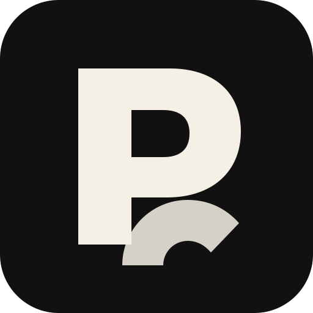

# LiuWei Skills

**Agent Skill 集合** —— 每个 Skill 一个目录，含 `SKILL.md` + 可执行脚本 + 回归测试。

> 仓库原名 `posterloom-sklls`（沿用不改），现已收纳多个 Skill。



---

## 📚 这里有什么

| # | Skill | 目录 | 一句话 |
|---|---|---|---|
| 1 | **PosterLoom**<br>照片转海报 | [`posterloom/`](posterloom/) | 读懂照片，自适应选风格，生成平面印刷风海报 |
| 2 | **参考图片全画布高精度复现为可编辑 PowerPoint 工程**<br>`Reference-Image-to-Full-Canvas-Editable-PPTX` | [`office/reference-image-to-pptx/`](office/reference-image-to-pptx/) | 把一张参考图**重建**为可编辑 PPTX：原生框体 / 文字 / 箭头，图标重绘为 SVG |

**分类**

| 栏目 | 内容 |
|---|---|
| [🎨 海报生成 Poster](posterloom/) | 照片 → 风格路由 → 印刷级海报 |
| [🗂️ 办公 Office](office/) | 参考图 → 可编辑 PowerPoint |

### ① PosterLoom —— 照片转海报

```bash
cd posterloom
python3 scripts/posterloom.py render photo.jpg --count 3
```

`--count 3` 产出**三种不同设计**（不是同一张的三个样本）：每张独立构造
`ARRANGEMENT:` 段、独立请求一次，三张保持同一风格 / 色板 / 媒介 / 身份锁。
详见下方 [⚡ 一条命令](#️-一条命令)。

### ② 参考图片 → 可编辑 PowerPoint

```text
用 reference-image-to-pptx skill 把这张参考图重建为可编辑的 PowerPoint。

- 参考图的完整像素画布作为唯一坐标基准，不要 contain、不要留白缩放
- 所有框体、文字、箭头用 PPT 原生对象重建，不要贴图
- 图标重绘为 SVG，渲染成 128×128 透明 PNG 后插入
- 渲染 PPT 并与参考图做全画布对比，至少校正两轮
- 最后给我可编辑 PPTX + 工程 ZIP + 图标素材 ZIP，并报告验收指标
```

详见下方 [🗂️ 办公 Office](#️-办公-office)。

---

## 🗂️ 办公 Office

独立办公类 Skill，放在仓库顶层 [`office/`](office/)。

| Skill | 目录 | 说明 |
|---|---|---|
| **参考图片全画布高精度复现为可编辑 PowerPoint 工程**<br>`Reference-Image-to-Full-Canvas-Editable-PPTX` | [`office/reference-image-to-pptx/`](office/reference-image-to-pptx/) | 把一张参考图**重建**为可编辑 PPTX：框体、文字、箭头全部是 PPT 原生对象，图标重绘为 SVG |

### 在哪 & 怎么装

| | |
|---|---|
| **GitHub** | `https://github.com/liuweispace/posterloom-sklls` |
| **仓库内路径** | `office/reference-image-to-pptx/` |
| **装到本机** | `~/.hermes/skills/reference-image-to-pptx/` |
| **正式 Skill 名** | `Reference-Image-to-Full-Canvas-Editable-PPTX` |

```bash
curl -fsSL https://github.com/liuweispace/posterloom-sklls/archive/refs/heads/main.tar.gz | tar xz
mv posterloom-sklls-main/office/reference-image-to-pptx ~/.hermes/skills/reference-image-to-pptx
```

装完**必须**跑一次自测确认：

```bash
cd ~/.hermes/skills/reference-image-to-pptx && python3 scripts/selftest.py
# 要看到: 40/40 PASS  SELFTEST OK
```

缺依赖（LibreOffice / pdftoppm / python-pptx / Pillow / NumPy）时对照
[`office/reference-image-to-pptx/templates/user-prompt.md`](office/reference-image-to-pptx/templates/user-prompt.md) 的排错表。

### 怎么用

上传参考图后直接说：

```text
用 reference-image-to-pptx skill 把这张参考图重建为可编辑的 PowerPoint。

- 参考图的完整像素画布作为唯一坐标基准，不要 contain、不要留白缩放
- 所有框体、文字、箭头用 PPT 原生对象重建，不要贴图
- 图标重绘为 SVG，渲染成 128×128 透明 PNG 后插入
- 渲染 PPT 并与参考图做全画布对比，至少校正两轮
- 最后给我可编辑 PPTX + 工程 ZIP + 图标素材 ZIP，并报告验收指标
```

更严格的版本（含 8 条工程要求 + 9 条验收要求）在
[`office/reference-image-to-pptx/templates/user-prompt.md`](office/reference-image-to-pptx/templates/user-prompt.md)。

**如果助手说找不到这个 skill**，直接说：

```text
先读一下 ~/.hermes/skills/reference-image-to-pptx/SKILL.md，按里面的流程做。
```

### 它保证什么

核心约束：**参考图的像素画布就是唯一坐标系**。所有对象在参考图像素坐标中测量，
直接映射到页面 —— 没有 `uniform_scale`，没有 `offset_x/offset_y`，没有 contain / fit / letterbox。

验收不是"看起来差不多"，而是渲染 PPT 后与参考图做全画布像素比对：

| 指标 | 阈值 |
|---|---|
| 页面宽高比误差 | 0 |
| 水平 / 垂直占用率误差 | ≤ 0.5% |
| 内容中心 X / Y 误差 | ≤ 0.3% |
| 四个主框体每条边误差 | ≤ 3–5 个参考像素 |
| 对象越界 / 文字溢出 / Freeform 箭头 / 嵌入参考图 | 0 |

### 安装与自测

```bash
cp -r office/reference-image-to-pptx ~/.hermes/skills/

cd office/reference-image-to-pptx
python3 scripts/selftest.py     # 端到端：真实渲染 + 全部阈值校验
```

依赖：Python 3.10+、Pillow、NumPy、python-pptx、LibreOffice（渲染验收必需）。
原始 24 节完整规格书：[`office/reference-image-to-pptx/references/SPEC-original.md`](office/reference-image-to-pptx/references/SPEC-original.md)

---

## 📦 安装

### 全部装上

```bash
curl -fsSL https://github.com/liuweispace/posterloom-sklls/archive/refs/heads/main.tar.gz | tar xz
mv posterloom-sklls-main/posterloom ~/.hermes/skills/posterloom
mv posterloom-sklls-main/office/reference-image-to-pptx ~/.hermes/skills/reference-image-to-pptx
```

### 只装一个

```bash
# 海报
mv posterloom-sklls-main/posterloom ~/.hermes/skills/posterloom

# 办公
mv posterloom-sklls-main/office/reference-image-to-pptx ~/.hermes/skills/reference-image-to-pptx
```

给 Hermes 的自然语言指令：

```text
现在帮我从 github 安装这个 posterloom-sklls，
把里面的 posterloom 和 office/reference-image-to-pptx 都装上，
之后生成海报用 posterloom，做可编辑 PPT 用 reference-image-to-pptx。
```

PosterLoom 需要 Python 3.9+，**仅用标准库** —— 无第三方依赖，无网络访问。
办公 Skill 需要 Python 3.10+、Pillow、NumPy、python-pptx、LibreOffice（渲染验收必需）。

---

## ⚡ 一条命令

```bash
cd posterloom
python3 scripts/posterloom.py render photo.jpg --count 3
```

从像素测量图片 → 选风格 → **直接生成 3 张成品图**。

`--count 3` 产出的是**三种不同设计**，不是同一张的三个随机样本：
每张图独立构造 `ARRANGEMENT:` 段、独立发起一次请求，三张保持同一风格、
同一色板、同一媒介、同一身份锁，只改变裁切、主体位置、留白与排列方式。

没有生图后端时用 `make`——它只输出 prompt 不出图：

```bash
python3 scripts/posterloom.py make photo.jpg
```

它会告诉你测到了什么、选了哪个风格、**哪些它决定不了**（主体类型、身份锚点、情绪需要你看）。

常用变体：

```bash
# 人像 —— 身份锁自动开启
python3 scripts/posterloom.py make photo.jpg --type portrait \
  --anchors "face shape,eye shape,hairline" --mood "quiet,intimate"

# "再艺术点" —— 解锁艺术向风格，但保住长相
python3 scripts/posterloom.py make photo.jpg --type portrait --tolerance high --tags artistic

# 给一张参考海报，匹配最接近的内置风格
python3 scripts/posterloom.py make photo.jpg --reference ref-poster.jpg

# 只出 prompt 不出图（无生图后端时用）
python3 scripts/posterloom.py make photo.jpg --json

# 强制某个风格 + 单张
python3 scripts/posterloom.py render photo.jpg --style riso-poster --count 1

# 附原图（会强烈拉回摄影渲染，慎用）
python3 scripts/posterloom.py render photo.jpg --send-reference
```

---

## 🧵 这是什么

**PosterLoom** 是一个把真实照片转成艺术海报的 Agent Skill。

它 **不是** 图像生成模型。它负责的是：

- 从像素测量画面（尺寸、宽高比、主色族、明度、对比度、饱和度、边缘密度、显著 / 安静区域、文字安全区）；
- 用不测量就没法判断的字段（主体类型、身份锚点、情绪）明确交回给你，而不是瞎猜；
- 保护原图的识别特征（人物脸部、建筑几何、材质、真实文字）；
- 在 35 个直接视觉风格中自动选一种，或在两个明确兼容的风格之间启用受控混合（`Controlled Hybrid`）；
- 重新组织构图；
- 应用克制的小字号排版；
- 按反 AI 套路化清单对结果做 QA。

要生成最终海报，宿主 Agent 需要具备图像生成或图像编辑能力。如果没有，PosterLoom 也会返回完整的路由决策和生成 Prompt。

## 🎨 风格库

PosterLoom 自带 **36 个风格契约**（35 个直接风格 + 1 个元风格），归属 **8 个家族**。每一种风格都是一套完整的视觉系统：适用条件、主体保留策略、构图方法、光线语言、色彩逻辑、材质表达、排版规则、专属 Prompt 块、专属 Negative Prompt、常见失败模式、验收标准。

### 📷 摄影编辑 — 5 种

适合"还是照片，但已经像海报"的场景。

| 风格 | 适用 |
|---|---|
| Cinematic Editorial（电影编辑） | 叙事感的画面，电影宽幅，杂志封面气质 |
| Moody Night Editorial（夜色编辑） | 低光环境、暖色实用光、深色负空间、文化与私密感 |
| Travel Cover Poster（旅行封面） | 地点 + 季节 + 一个主体，意境大于写实 |
| Luxury Still-Life Editorial（奢华静物） | 产品或器物、高级材质、克制光线 |
| Documentary Poster（纪实海报） | 现场摄影的编辑感，克制胜于装饰 |

### 🖌️ 绘画氛围 — 5 种

把照片推向绘画或氛围媒介。

| 风格 | 适用 |
|---|---|
| Transparent Watercolor（透明水彩） | 安静的旅行、植物、户外 |
| Soft Gouache（柔和水粉） | 儿童、动物、暖色室内、轻盈色彩 |
| Expressive Painting（表现绘画） | 主体明确且情绪强烈，允许看见笔触 |
| Ink Wash Minimal（水墨极简） | 单个主体、大面积留白、诗意 |
| Pastel Atmosphere（粉彩氛围） | 柔光日景、梦境感、时尚 / 静物情绪 |

### 🖨️ 印刷图形 — 5 种

海报化、制版感、中世纪或 Riso 美学。

| 风格 | 适用 |
|---|---|
| Pop Screenprint（波普丝网） | 高反差主体、平面色、强海报感 |
| Riso Poster（Riso 海报） | 轻微错位、有限色板、独立 zine 调性 |
| Relief Print（凸版印刷） | 木刻 / 麻版质感、手作纹理 |
| Retro Lithograph（复古石印） | 复古编辑 / 旅行海报、叠层石印感 |
| Paper-Cut Graphic（剪纸图形） | 大块形状、插画化主体、叙事场景 |

### 🏯 东方 / 文化 — 5 种

主体本身与中式、日式或更广泛的东亚视觉文化相关。

| 风格 | 适用 |
|---|---|
| Neo Ink Poster（新水墨） | 现代水墨构图、大负空间、克制排版 |
| Tea-House Minimal（茶室极简） | 茶、木、夜色室内、文化静谧 |
| Classical Parchment（古典羊皮卷） | 书法或文学性主体、暖旧纸张 |
| Seal & Calligraphy Poster（印章与书法） | 主体配真实或风格化的印章 / 文字 |
| Folk Narrative Color（民间叙事色彩） | 民间工艺色板、叙事场景、慷慨配色 |

### 🌀 概念编辑 — 4 种

把照片变成一个概念性或编辑性表达。

| 风格 | 适用 |
|---|---|
| Editorial Surrealism（编辑超现实） | 强主体 + 一个被置换的概念元素 |
| Abstract Editorial（抽象编辑） | 把主体收敛为形状 / 色块、杂志封面逻辑 |
| Minimal Symbolic Poster（极简符号） | 一个主体，近似当作单一符号 |
| Collage-Lite Narrative（轻拼贴叙事） | 两个叠加的概念，但视觉保持干净（不是 moodboard） |

### 🧱 现代设计 — 5 种

根植于 20 / 21 世纪设计语言。

| 风格 | 适用 |
|---|---|
| Swiss Grid Poster（瑞士网格） | 强网格、无衬线、几何色 |
| Brutalist Poster（粗野主义） | 粗砺、巨大、非对称、反"漂亮" |
| Neo-Futurist Layout（新未来布局） | 建筑感主体、技术线条语言 |
| Geometric Color-Block（几何色块） | 强色彩 / 时尚 / 建筑主体、平面色 |
| Elegant Serif Poster（优雅衬线） | 杂志封面、时尚、美学、高端 |

### 📄 纸感拼贴 — 2 种

从公开 skill `gathered-scenes-zine-skill` 的方法论学习而来，做成可路由、可强制、可验证的风格条目。

| 风格 | 适用 |
|---|---|
| Gathered Scenes Zine（实景拼贴） | 旅行 / 风景 / 建筑 / 器物。照片保留为事实锚点，更大的抽象插画场重新解释源元素，手撕纤维边，一个高彩度色相作为结构 |
| Scene Distillation Zine（影像蒸馏） | 情绪表达 / 概念海报 / 系列。照片仅作语义证据，输出纯插画 + 纸 + 文字，不含任何照片像素 |

### 🧍 人像 — 4 种

需要保住长相时优先选用。

| 风格 | 适用 |
|---|---|
| Editorial Portrait（编辑人像） | 杂志 / 采访人像，自然肤色 |
| Photojournalistic（新闻纪实） | 最高保真度，抓拍瞬间 |
| Fine-Art Portrait（艺术人像） | 绘画表面，长相保持不变 |
| Duotone Identity Stack（双调身份堆叠） | 同一个已验证身份刻意重复的平面海报 |

### 🧬 元风格 — 1 种

| 风格 | 适用 |
|---|---|
| Controlled Hybrid（受控混合） | 两个直接风格排名接近且明确兼容；二级风格只允许控制一个子系统（排版 / 负空间 / 印刷质感 / 墨边 / 网格 / 分色 / 氛围）。默认 ≈ 80% 主风格 + 20% 次风格。不允许 50/50 平均。 |

## 🔒 人脸身份锁 — 三种模式

任何含可识别人脸的源图都会在 prompt 中注入身份锁。锁的模式由**路由到的风格**决定，不由模型决定：

| 模式 | 适用 | 锁的内容 |
|---|---|---|
| `single` | 绝大多数风格 | 复现源脸：脸型、眼型间距、眉形、鼻嘴、颌线、发际线、肤色、年龄、表情、视线 |
| `repeat` | Duotone Identity Stack | 同一个已验证身份重复 N 次，不得漂移成别人或平均脸 |
| `abstract` | Scene Distillation Zine | **派生锁**：必须能追溯到源（头型、头角度、发际线、年龄线索、姿态、视线），但必须渲染成插画而非照片 |

抽象模式**不是关掉锁**，是把它重述成这个风格唯一能兑现的形式：泛化渲染，不泛化身份。

配套护栏：需要保住长相的人像**不会**被路由进重绘媒介或抽象身份风格，除非你显式要求重度变换。提示语会说明原因。

## 🧭 路由流程

1. **测量** —— `analyze` 从像素读出尺寸、宽高比、主色族、明度、对比度、饱和度、边缘密度、显著 / 安静区域、文字安全区。
2. **交回语义字段** —— 主体类型、身份锚点、情绪、变换容忍度无法从像素可靠得出，列进 `TODO` 交给你，而不是编造。
3. **打分** —— 对 35 个直接风格按 subject / lighting / mood / geometry / materials / palette / realism / transform 加权打分。
4. **护栏** —— 人像按身份风险加保护分；重绘媒介与抽象身份风格在需要保脸时被排除。
5. **取最高分** —— 如果允许、且第二名与之明确兼容，激活 `Controlled Hybrid`。
6. **只加载当前风格的契约** —— 一次性不读全部 36 份。
7. **编译最终 Prompt 与 Negative Prompt** —— 含具名色板的 hex 值。
8. **生成一张海报，跑 Anti-Slop QA** —— 禁止蓝紫渐变、随机雾、假胶片边框、虚构地标等。

## 🔬 可选工具

| 命令 | 作用 |
|---|---|
| `posterloom.py analyze` | 只测量，产出 profile |
| `posterloom.py match` | 参考海报 → 最接近的内置风格 |
| `posterloom.py make` | 一条命令走完全流程 |
| `posterloom.py route / prompt / batch` | 排序 / 编译 / 批量规划 |
| `posterloom.py styles / show` | 列出风格 / 查看单个合约 |
| `posterloom.py selftest` | 6 项完整性检查 |
| `evals/run_evals.py` | 35 例路由回归 |

---

## 🗂️ 项目架构

```text
posterloom-sklls/               # LiuWei Skills 集合
├── README.md
├── README.en.md
├── README.zh-CN.md
├── LICENSE
├── CHANGELOG.md
├── VERSION
├── CODE_OF_CONDUCT.md
├── CONTRIBUTING.md
├── SECURITY.md
├── posterloom/                  # Skill ① —— 照片转海报
│   ├── SKILL.md
│   ├── styles/                  # 36 个 Style Contract
│   ├── references/              # 渐进式加载的规范
│   ├── data/                    # 路由 + 兼容性数据 + 具名纸基油墨
│   ├── scripts/                 # 确定性辅助脚本
│   ├── evals/                   # 路由回归 + 视觉打分模板
│   ├── schemas/
│   ├── examples/
│   └── assets/
└── office/                      # 办公栏目
    ├── README.md
    └── reference-image-to-pptx/ # Skill ② —— 参考图 → 可编辑 PPTX
        ├── SKILL.md
        ├── scripts/              # 引擎 / 校验 / 图标 / manifest / 打包 / 自测
        ├── references/
        │   ├── SPEC-original.md  # 原始 24 节完整规格书
        │   └── field-notes.md    # 实测踩坑与根因
        └── templates/
            └── user-prompt.md    # 三档用户提示词
```

---

## ⚖️ License

MIT License。

仓库代码和 PosterLoom 原创 Skill 内容按 MIT 发布。

用户自己的原始照片、第三方素材以及最终生成图片的权利，仍然取决于照片本身、相关素材许可，以及所使用图像生成服务的条款。
